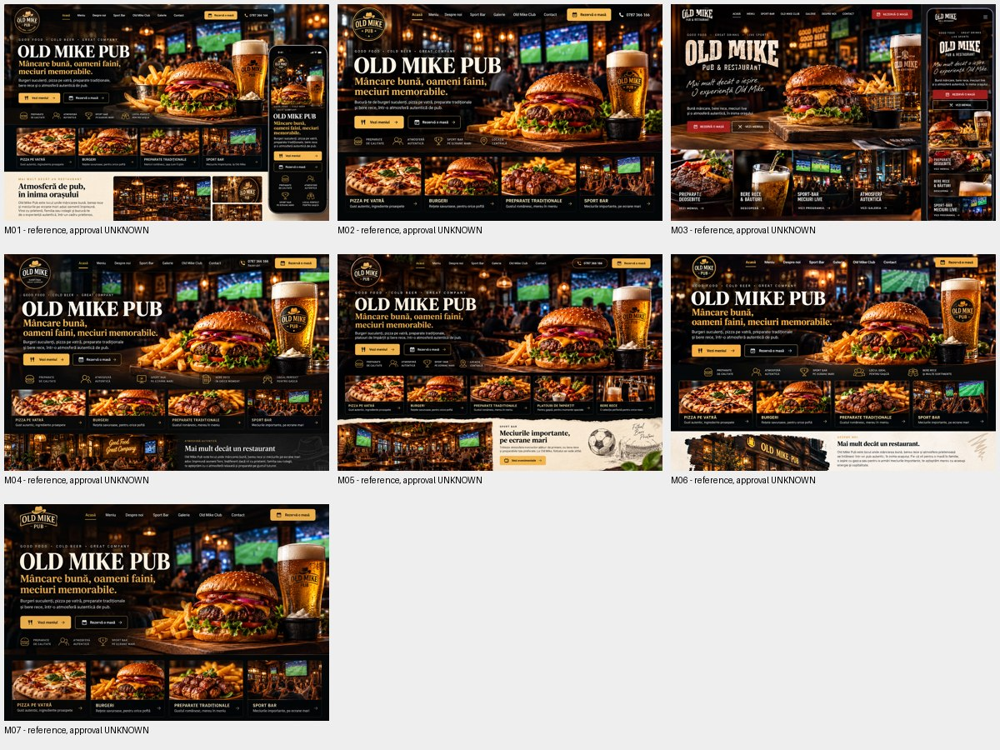

# Design recuperat

## Direcție deja stabilită

Premium, minimalist, cinematic, hero dominant, imagini culinare realiste și câteva animații fluide. Logo oficial integral. CTA clare pentru meniu, club și apel telefonic. Prioritate mobil. Nu se redeschide această direcție printr-un nou proiect/template.

## Catalogul mock-up-urilor

Cele șapte PNG au fost recuperate și inspectate vizual. Numerotarea de mai jos este un identificator de audit, nu o ordine de aprobare. Toate au 1536 × 1024 px. Originalele rămân în materialele proiectului; inventarul include identificatorii și SHA-256. Catalogul JPEG este numai o referință documentară, nu asset pentru homepage.

| ID | Fișier original | Observație vizuală, fără aprobare implicită |
|---|---|---|
| M01 | Old Mike Pub Website Mockup(1).png | Hero burger/bere, logo rotund, inserție mobil, secțiune atmosferă |
| M02 | Old Mike Pub: Gust, Sport și Atmosferă.png | Hero pe fundal de pub și ecrane; patru blocuri de categorii |
| M03 | Old Mike Pub Website Mockup.png | Accent roșu, logo tip lettering, comparație desktop/mobil |
| M04 | Old Mike Pub – Mâncare, Bere și Meciuri.png | Logo rotund, burger/bere, blocuri preparate și atmosferă |
| M05 | Old Mike Pub: Mâncare, Bere și Fotbal.png | Categorii inclusiv platouri și bere; bandă sport pe fundal deschis |
| M06 | Old Mike Pub: Mâncare, Bere și Meciuri(1).png | Hero burger/bere, bandă beneficii, categorii, secțiune deschisă „Despre noi” |
| M07 | Old Mike Pub: Mâncare, Bere și Meciuri.png | Compoziție apropiată de M06, homepage mai scurt |

Mock-up-urile sunt imagini de referință: conțin logo-uri/texturi/texte generate și elemente care pot să nu reprezinte localul sau oferta exactă. Nu extrage de aici identitatea oficială, programul, oferta sau afirmații precum „pizza pe vatră” fără validare. Un telefon desenat în mock-up nu dovedește comportamentul responsive al codului.

## Diferența față de implementarea existentă

| Element | Hero v1 din cod | Referințe recuperate |
|---|---|---|
| Imagine dominantă | Două imagini încadrate în forme rotunjite, burger + bere | Scenă amplă cu burger, cartofi, bere și pub/sport în fundal |
| Tipografie | Outfit foarte bold + DM Sans | Titluri predominant serif/display, cu alte proporții |
| Paletă | Maro închis, cupru, crem, auriu | Predominant negru/maro cald și auriu; M03 are roșu |
| Conținut | Hero, marquee, contact | Multe variante includ și categorii, sport, atmosferă/despre noi |
| Mișcare | Floating continuu, marquee, apariție la încărcare | Imaginile statice nu demonstrează animațiile aprobate |

FACT: există această diferență. UNKNOWN: dacă utilizatorul a aprobat hero v1 sau o anumită variantă M01–M07. Nu declara v1 „designul final aprobat”.

## Elemente implementabile fără redeschiderea deciziilor

Link-uri meniu/club și `tel:+40787366166`; navigare mobilă accesibilă; păstrarea logo-ului oficial; optimizarea livrării imaginilor; mișcare redusă; structură statică independentă; verificări de lizibilitate și lipsă overflow. Acestea sunt scope pentru M1 după prezentarea checkpoint-ului, nu schimbări efectuate în M0.

## Elemente care necesită dovadă de aprobare sau revalidare punctuală

Mock-up-ul final; compoziția hero-ului (scenă amplă versus decupaje); imaginea de bază și fidelitatea produselor; paleta/fonturile finale; sloganul și textele; secțiunile secundare și ordinea lor; folosirea fotografiilor reale în hero/galerie. Nu cere utilizatorului să reconfirme telefonul, separarea aplicațiilor sau direcția cinematică.
